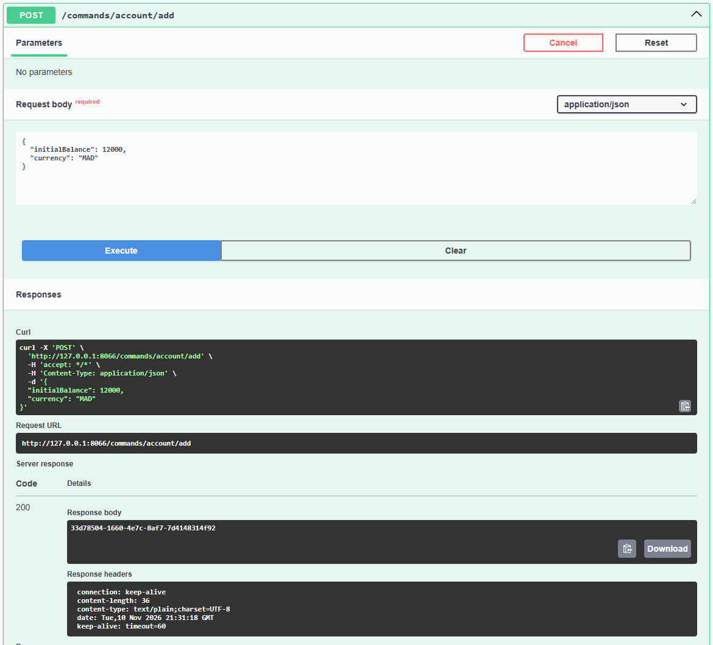
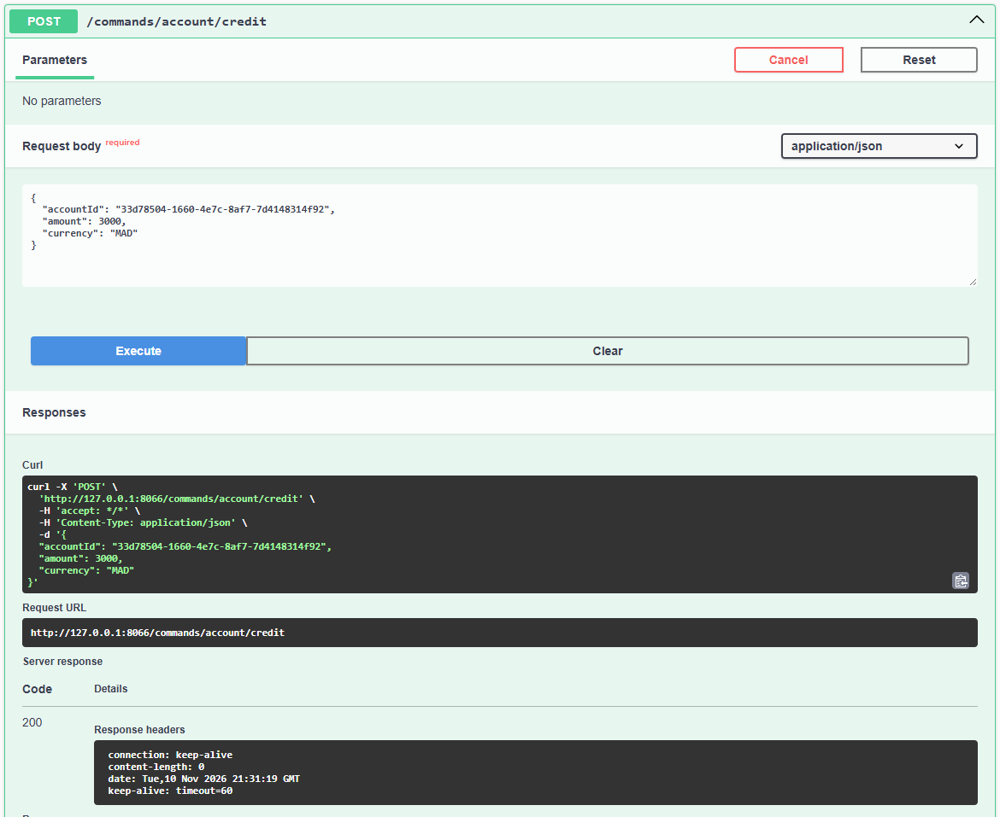
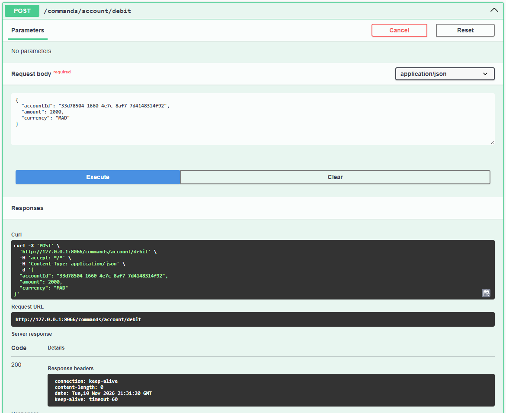
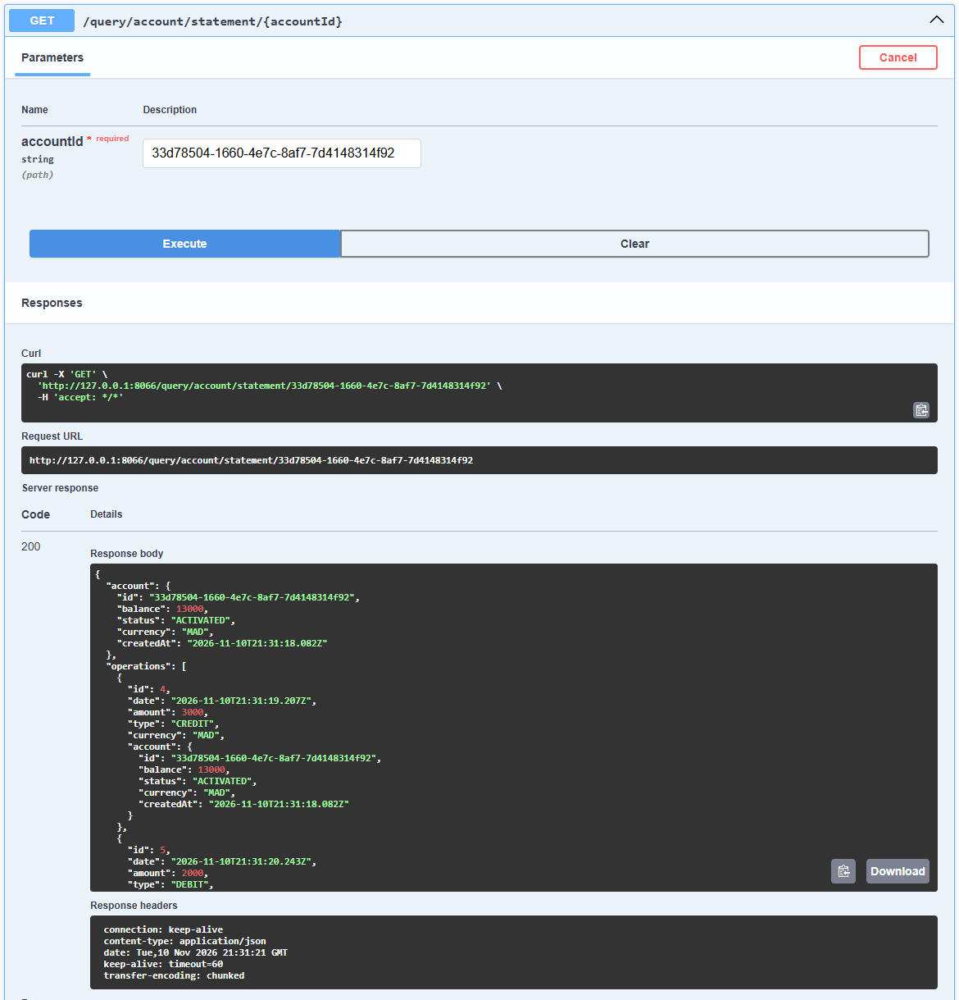
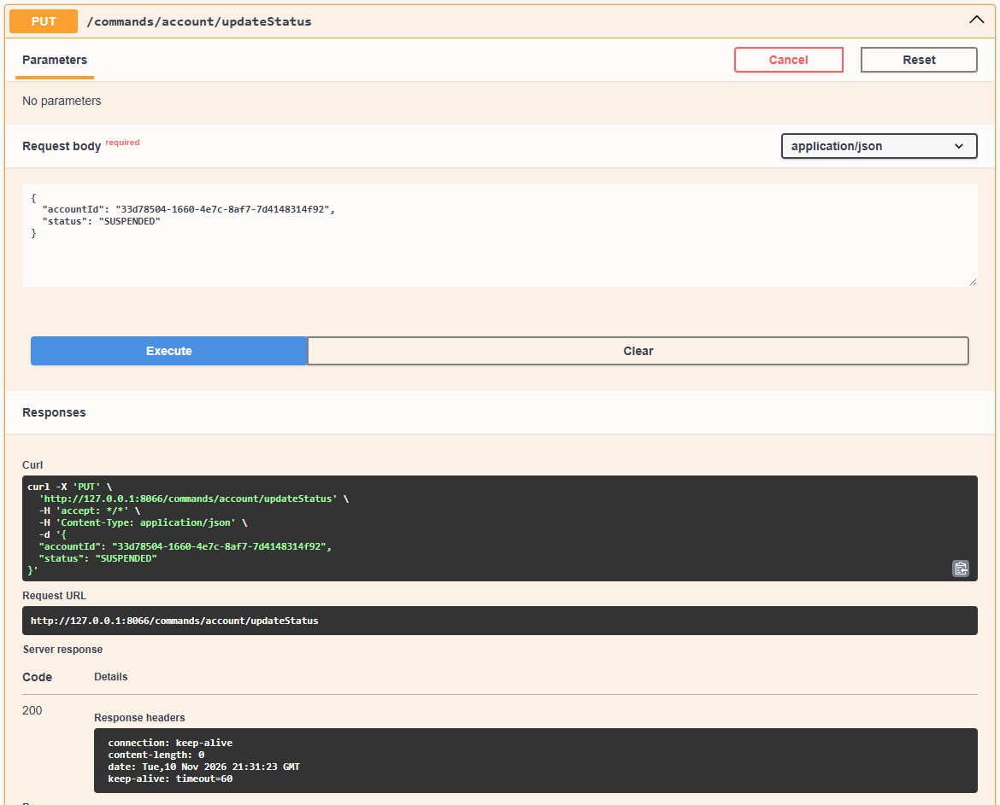
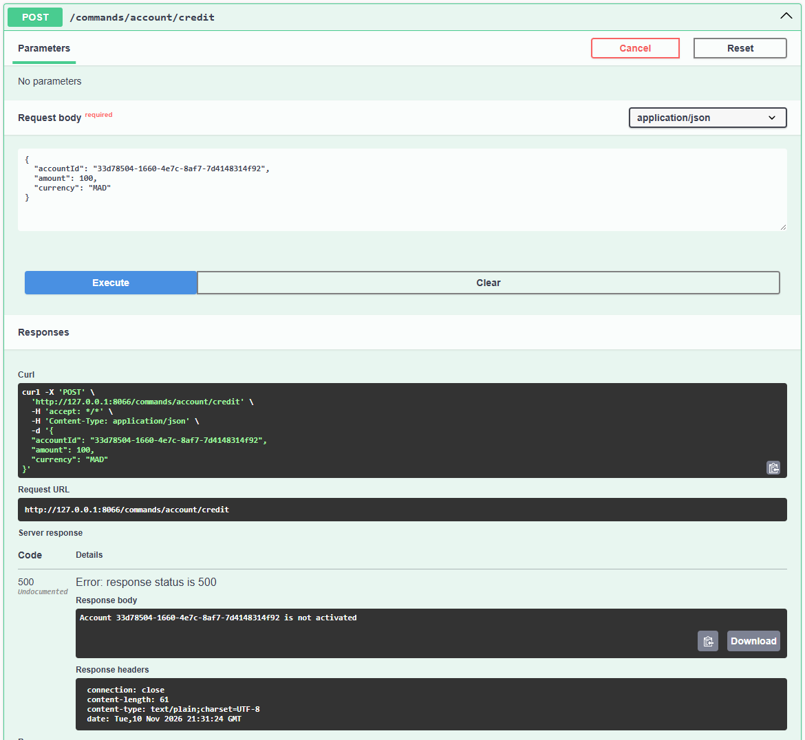
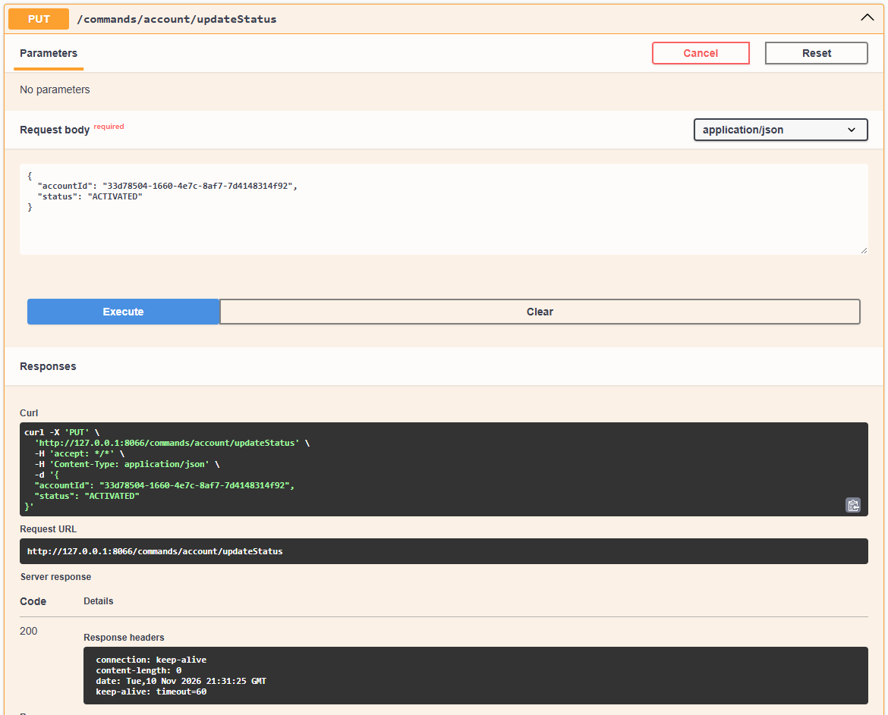
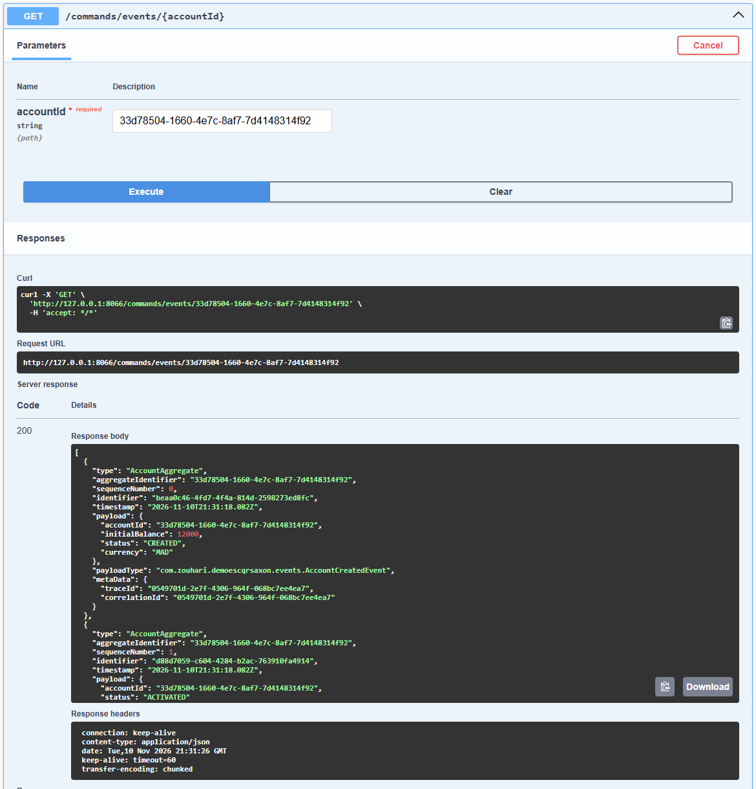

# Rapport  Gestion bancaire avec CQRS et Event Sourcing

## L'idée du projet

Cette application permet de gérer des comptes bancaires : créer un compte, ajouter ou retirer de l'argent, consulter le solde et suspendre ou réactiver un compte.

Elle repose sur deux idées simples :

- **CQRS** : séparer les actions qui modifient les comptes de celles qui consultent les informations.
- **Event Sourcing** : conserver chaque changement sous forme d'événement pour retrouver l'historique et reconstruire l'état du compte.

Le projet utilise **Java, Spring Boot et Axon Framework**. Les tests ci-dessous ont été réalisés dans **Swagger UI**, sur l'application en cours d'exécution.

## Démonstration en captures

### 1. Création d'un compte

Un compte est créé avec un solde initial de **12 000 MAD**.

### 2. Crédit du compte

L'ajout de **3 000 MAD** est accepté.

### 3. Débit du compte

Le retrait de **2 000 MAD** est accepté.

### 4. Consultation du relevé

Le relevé affiche les deux opérations et le solde de **13 000 MAD**.

### 5. Refus d'un retrait trop élevé

Le retrait de **20 000 MAD** est refusé : le solde est insuffisant.

### 6. Suspension du compte

Le changement de statut vers **SUSPENDED** est accepté.

### 7. Opération refusée sur le compte suspendu

Un crédit est refusé tant que le compte est suspendu.

### 8. Réactivation du compte

Le compte est remis au statut **ACTIVATED**.

### 9. Consultation de l'historique

L'historique conserve les événements des actions acceptées. Voici le début de la réponse.

## Bilan

Le projet montre comment gérer un compte tout en gardant la trace de ses changements. Les opérations et les contrôles métier ont été vérifiés ; le solde final reste de **13 000 MAD**.
